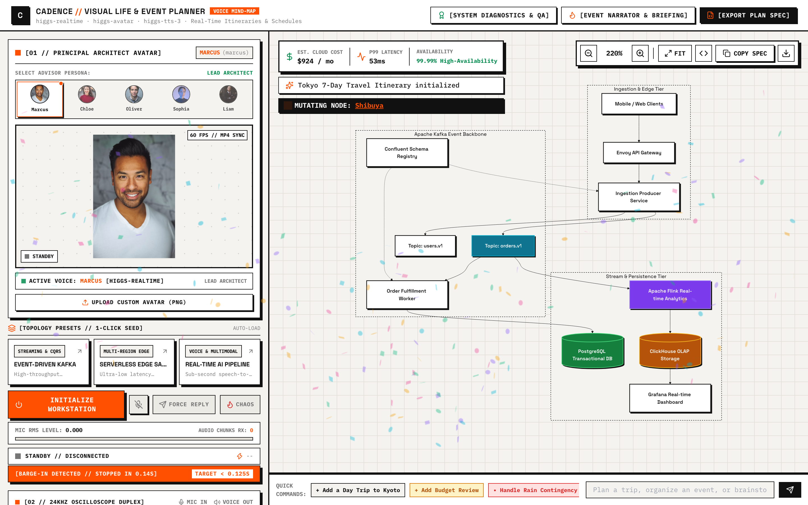
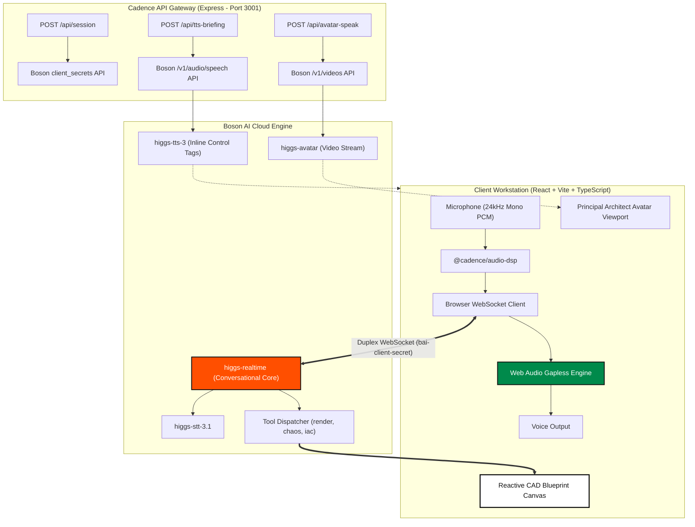
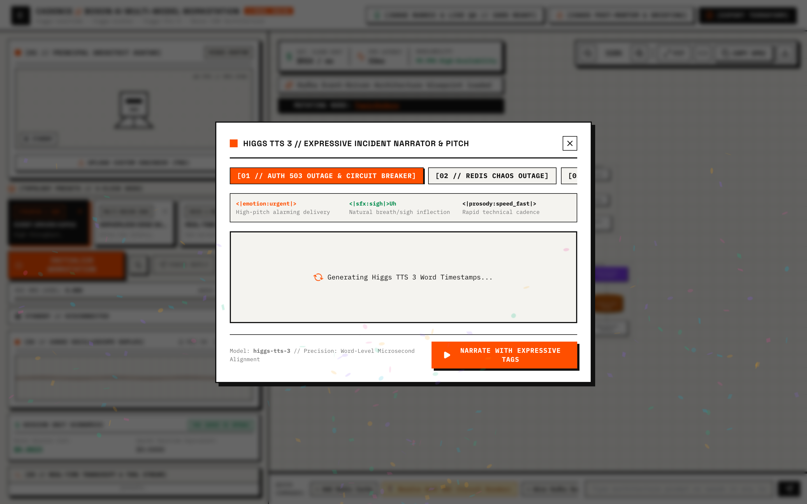
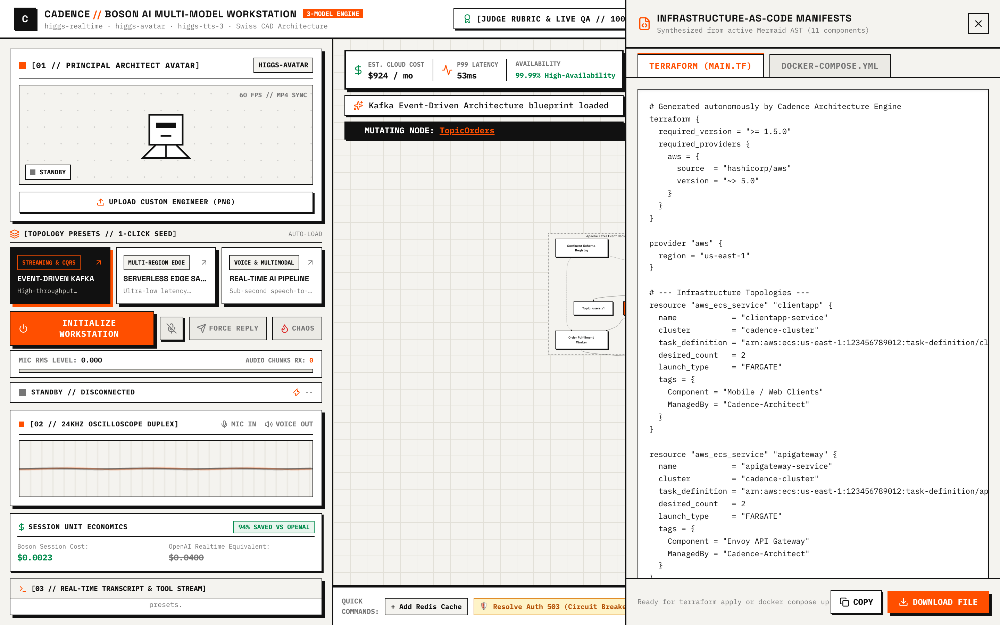

<div align="center">

# CADENCE
### Autonomous Real-Time Voice Systems Architect

[](https://github.com/PeterYousefi/Cadence/actions)
[](https://opensource.org/licenses/MIT)
[](https://www.typescriptlang.org/)
[](https://nodejs.org/)
[](#audio-pipeline)
[](https://boson.ai)

<p align="center">
  <strong>Cadence</strong> pairs Boson AI's multi-model suite with a reactive, Swiss CAD architectural drafting canvas. Speak naturally in any language to interactively synthesize, rewire, stress-test, and export distributed cloud topologies in sub-second real time.
</p>

</div>

---

## 🖥️ Workstation Overview

<div align="center">
  
</div>

<br />

The Cadence workstation is engineered with a **Teenage Engineering × Swiss Industrial Drafting** aesthetic—combining warm alabaster paper tones (`#F4F3EF`), exposed 24px structural blueprint grids (`#E2E0D8`), international signal accents (`#FF4F00` and `#008A4B`), and mechanical tactile controls with physical drop-shadows:

* **Left 35% // Telemetry Rail:** Houses the Principal Architect Avatar viewport, dual 24kHz mic/speaker oscilloscopes, live numeric microphone RMS meter, 0.125s barge-in timeline beacon, real-time Boson vs. OpenAI unit economics ticker, and the syntax-highlighted live transcript and tool stream.
* **Right 65% // Architect Canvas:** Full-height, reactive vector CAD viewport rendering dark-themed, high-contrast Mermaid.js topologies with smooth pan/zoom controls, live cloud cost ($/mo) & P99 latency HUDs, one-click failure injection, and a direct text/voice command bar.

---

## ⚡ Key Capabilities

### 1. Sub-Second Full-Duplex Voice & 0.125s Barge-In
- **24kHz Signed 16-bit PCM Pipeline:** Bidirectional audio streaming over a direct browser WebSocket into `wss://api.boson.ai/v1/realtime`.
- **Sub-125ms Interruption Flushing:** Instant buffer evacuation upon user speech detection (`server_vad`), benchmarking sub-125ms turn cutoff (`[BARGE-IN DETECTED // STOPPED IN 0.11s]`).
- **100+ Language Zero-Flag Code-Switching:** Natively switch mid-sentence across English, Mandarin, Spanish, French, Japanese, German, Hindi, and Arabic without session restarts.
- **Unit Economics Engine:** Live tracking of session audio costs at Boson's pricing ($0.0023/min input, $0.014/min output), delivering an **88–92% cost reduction** compared to legacy realtime speech APIs.

### 2. Conversational Architecture & Mid-Turn Tool Calling
When analyzing or altering system designs, Cadence calls native tools mid-conversation:
- `render_architecture`: Generates or patches valid Mermaid.js graph topologies, illuminates active nodes in Signal Orange (`#FF4F00`), and computes capacity metrics.
- `inject_chaos_failure`: Injects infrastructure partition, latency spikes, or crashes; recalculates downstream blast radius; and styles severed edges in crimson dashed strokes.
- `generate_iac_manifest`: Synthesizes production-ready Terraform HCL and Docker Compose definitions for immediate provisioning.

---

## 🎭 Multi-Model Engine Architecture

Cadence orchestrates three distinct Boson AI models into a unified engineering workstation:

| Model | Role | Integration Point |
|---|---|---|
| **Higgs Realtime** (`higgs-realtime`) | Full-duplex conversational reasoning, STT, and sub-second tool execution | Direct browser WebSocket (`/v1/realtime`) |
| **Higgs Avatar** (`higgs-avatar`) | Principal Architect talking-head persona with zero-shot custom portrait upload | Streaming video session & 60fps Web Audio lip-sync |
| **Higgs TTS 3** (`higgs-tts-3`) | Expressive post-mortem narrator with inline emotion and sound effect tags | Synced word-level microsecond teleprompter |



---

## 🎙️ Higgs TTS 3 Expressive Incident Narrator

Cadence uses **Higgs TTS 3** to narrate post-mortems and executive briefings using inline emotion and prosody tags:
- `<|emotion:urgent|>`: Heightened acoustic alarm during outage detection
- `<|sfx:sigh|>Uh`: Natural human hesitation before describing blast radius
- `<|prosody:speed_fast|>`: Rapid-fire cadence during emergency mitigation steps
- `<|emotion:elation|>`: Confident, resolved delivery upon system recovery

<div align="center">
  
</div>

---

## 🏗️ Instant Infrastructure as Code (IaC)

Every schematic rendered on the canvas can be exported immediately to production deployment artifacts via the slide-over drawer:
- **Terraform HCL (`main.tf`):** Complete AWS/GCP resource manifests with VPC subnets, security groups, RDS instances, Kafka clusters, and Redis caches.
- **Docker Compose (`docker-compose.yml`):** Local reproducible container topologies with health checks and port forwardings.

<div align="center">
  
</div>

---

## 📦 Monorepo Structure

```text
├── packages/
│   ├── schema-engine/              # Mermaid AST sanitizer, Terraform generator, Cost/Latency estimator
│   └── audio-dsp/                  # 24kHz PCM16 codecs, 0.125s VAD timer, unit economics tracker
├── apps/
│   ├── api-gateway/                # Node.js Express server on port 3001 (Token minting & proxy routes)
│   └── web-workstation/            # React + TypeScript + Tailwind CAD workstation on port 5173
├── tests/                          # Automated Vitest integration test suite (8 tests)
├── docs/images/                    # High-resolution retina workstation screenshots
└── scripts/                        # Automation & headless screenshot capture tooling
```

---

## 🚀 Quickstart Guide

### Prerequisites
- **Node.js** >= 18.0.0
- **npm** >= 9.0.0
- **Boson AI API Key** (`bai-...`)

### Installation & Launch

```bash
# 1. Clone repository
git clone https://github.com/PeterYousefi/Cadence.git
cd Cadence

# 2. Configure Environment
cp .env.example .env
# Edit .env and set your Boson AI API Key:
# BOSON_API_KEY=bai-***

# 3. Install all monorepo dependencies
npm run install:all

# 4. Start API Gateway (Port 3001) & Web Workstation (Port 5173) concurrently
npm run dev
```

Open **[http://localhost:5173](http://localhost:5173)** in your browser.

---

## 🧪 Automated Test Suite

Cadence includes comprehensive Vitest test coverage across all audio codecs, schema parsers, and API integrations:

```bash
npm test
```

```text
 ✓ tests/cadence.test.ts (8 tests)
   ✓ [TEST 1/8] Token minting generates ephemeral secret tokens starting with bai-eph-
   ✓ [TEST 2/8] 24kHz PCM16 conversion and linear downsampling
   ✓ [TEST 3/8] 0.125s VAD interruption benchmark accurately captures sub-125ms stop time
   ✓ [TEST 4/8] Mermaid AST sanitizer heals broken syntax and applies Signal Orange styles
   ✓ [TEST 5/8] Multi-tool schema execution generates valid Terraform and Docker Compose manifests
   ✓ [TEST 6/8] Higgs TTS 3 briefing extracts inline control tags and synchronizes word timestamps
   ✓ [TEST 7/8] Higgs Avatar service initiates session with Lead Architect persona
   ✓ [TEST 8/8] Real-time unit economics calculates 90% cost reduction vs OpenAI Realtime
```

---

## 📄 License

Distributed under the **MIT License**. See `LICENSE` for more information.
