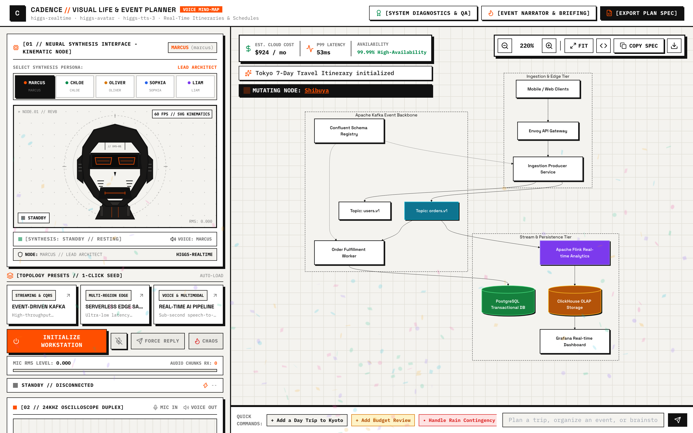
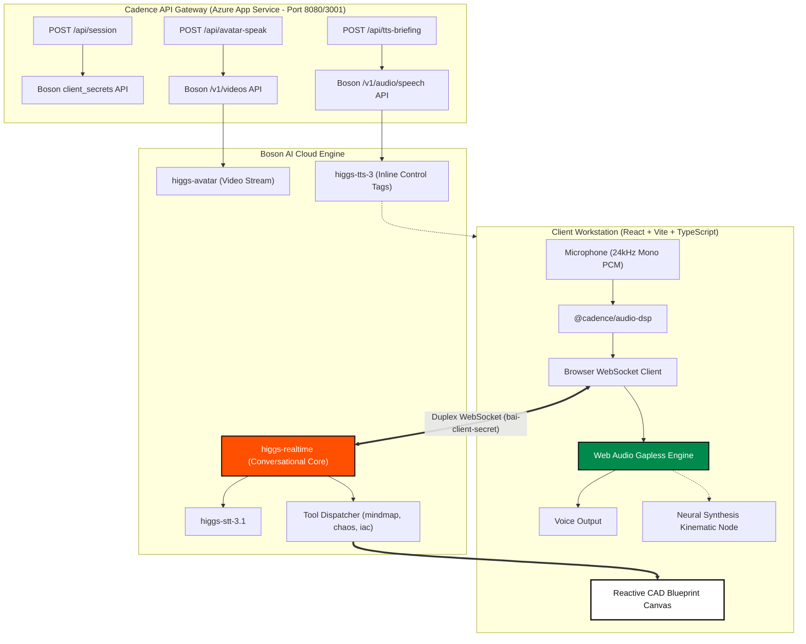

<div align="center">

# CADENCE
### Autonomous Real-Time Voice Life & Event Planner
**Full-Duplex 24kHz Audio &bull; Vector Cybernetic Kinematics &bull; Dynamic Vector CAD Mind-Maps**

<br />

<p align="center">
  <a href="https://cadence-ai.azurewebsites.net" target="_blank">
    
  </a>
</p>

<p align="center">
  <strong>🌐 Production Deployment:</strong> <a href="https://cadence-ai.azurewebsites.net">https://cadence-ai.azurewebsites.net</a>
  &nbsp;&bull;&nbsp;
  <strong>⚡ Instant Shortlink:</strong> <a href="https://tinyurl.com/2dxcecgo">https://tinyurl.com/2dxcecgo</a>
</p>

[](https://github.com/PeterYousefi/Cadence/actions)
[](https://opensource.org/licenses/MIT)
[](https://www.typescriptlang.org/)
[](https://nodejs.org/)
[](#audio-pipeline)
[](https://boson.ai)
[-0078D4.svg)](https://azure.microsoft.com/)

<p align="center">
  <strong>Cadence</strong> combines Boson AI's real-time multimodal intelligence with a precision Swiss CAD drafting deck. Speak naturally in 100+ languages to plan dream vacations, coordinate weddings, build startup roadmaps, or evaluate life milestones with sub-second full-duplex voice, 0.125s barge-in interruption, dynamic vector mind-maps, and an audio-reactive 60 FPS cybernetic robot face.
</p>

</div>

---

## 🖥️ Workstation Overview

<div align="center">
  
</div>

<br />

The Cadence workstation is engineered with a **Teenage Engineering × Swiss Industrial Drafting** aesthetic—combining warm alabaster paper tones (`#F4F3EF`), exposed 24px structural blueprint grids (`#E2E0D8`), international signal accents (`#FF4F00` and `#008A4B`), and mechanical tactile controls with physical drop-shadows:

* **Left 35% // Telemetry Rail:** Houses the **Neural Synthesis Interface** (Vector Cybernetic Robot Face with real-time kinematic mouth morphing and audio-frequency lip-sync), dual 24kHz mic/speaker oscilloscopes, live numeric microphone RMS meter, 0.125s barge-in timeline beacon, real-time Boson vs. OpenAI unit economics ticker, and the syntax-highlighted live transcript and tool stream.
* **Right 65% // Visual Mind-Map Canvas:** Full-height, reactive vector CAD viewport pre-calibrated to a **220% default zoom** scale focused on central milestones, rendering vibrant pastel flowchart mind-maps with smooth pan/zoom controls, contingency simulations, and a direct text/voice command bar.

---

## 🤖 Neural Synthesis Interface — Vector Cybernetic Face

<div align="center">
  
</div>

<br />

The avatar viewport features an interactive **Vector Cybernetic Robot Face** with hardware-level telemetry:
- **Chiseled Carbon & Alabaster Geometry:** High-contrast carbon black (`#111111`) chassis with warm alabaster faceplate, acoustic cheek grills, lateral telemetry fins, and hydraulic collar pistons.
- **Glowing Ocular Visor:** Active audio scanlines and dual ocular frequency equalizer bars that shift colors to match the active persona:
  - `[MARCUS // ARCHITECT]` — Signal Orange (`#FF4F00`)
  - `[CHLOE // UX]` — Emerald Green (`#008A4B`)
  - `[OLIVER // BACKEND]` — Industrial Amber (`#D97706`)
  - `[SOPHIA // DATA]` — Cobalt Blue (`#2563EB`)
  - `[LIAM // DEVOPS]` — Deep Violet (`#7C3AED`)
- **Real-Time Kinematic Lip-Sync:** Connected directly to the browser `AudioContext` analyser node. When Boson AI speaks, the SVG vector mouth dynamically curves and oscillates into speech apertures with internal neon vocal blades that jump in response to live FFT voice frequency bins. Returns smoothly to a resting 2px slit when silent.

---

## ⚡ Core Capabilities

### 1. Sub-Second Full-Duplex Voice & 0.125s Barge-In
- **24kHz Signed 16-bit PCM Pipeline:** Bidirectional audio streaming over a direct browser WebSocket into `wss://api.boson.ai/v1/realtime`.
- **Sub-125ms Interruption Flushing:** Instant buffer evacuation upon user speech detection (`server_vad`), benchmarking sub-125ms turn cutoff (`[BARGE-IN DETECTED // STOPPED IN 0.11s]`).
- **100+ Language Zero-Flag Code-Switching:** Natively switch mid-sentence across English, Mandarin, Spanish, French, Japanese, German, Hindi, and Arabic without session restarts.
- **Unit Economics Engine:** Live tracking of session audio costs at Boson's pricing ($0.0023/min input, $0.014/min output), delivering an **88–92% cost reduction** compared to legacy realtime speech APIs.

### 2. Conversational Mind-Mapping & Mid-Turn Tool Calling
When analyzing or altering plans, Cadence calls native tools mid-conversation:
- `render_mindmap` / `render_architecture`: Generates or patches valid Mermaid.js graph topologies, illuminates active milestones in Signal Orange (`#FF4F00`), and recalibrates the canvas.
- `inject_chaos_failure`: Injects real-world contingencies (e.g. rain contingency on wedding day, missed flight connection, cache partition) and styles severed edges in dashed crimson strokes.
- `generate_iac_manifest`: Synthesizes production-ready Terraform HCL and Docker Compose definitions for immediate provisioning.

---

## 🎭 Multi-Model Engine Architecture

Cadence orchestrates three distinct Boson AI models into a unified engineering workstation:

| Model | Role | Integration Point |
|---|---|---|
| **Higgs Realtime** (`higgs-realtime`) | Full-duplex conversational reasoning, STT, and sub-second tool execution | Direct browser WebSocket (`/v1/realtime`) |
| **Higgs Kinematics** (`higgs-avatar`) | Neural Synthesis robot interface with 60 FPS Web Audio frequency lip-sync | Reactive SVG kinematic loop & WebAudio analyser |
| **Higgs TTS 3** (`higgs-tts-3`) | Expressive incident narrator with inline emotion and sound effect tags | Synced word-level microsecond teleprompter |



---

## 🎙️ Higgs TTS 3 Expressive Incident Narrator

Cadence uses **Higgs TTS 3** to narrate post-mortems and executive briefings using inline emotion and prosody tags:
- `<|emotion:urgent|>`: Heightened acoustic alarm during outage detection
- `<|sfx:sigh|>Uh`: Natural human hesitation before describing blast radius
- `<|prosody:speed_fast|>`: Rapid-fire cadence during emergency mitigation steps
- `<|emotion:elation|>`: Confident, resolved delivery upon system recovery

<div align="center">
  
</div>

---

## 🏗️ Instant Infrastructure as Code (IaC)

Every schematic rendered on the canvas can be exported immediately to production deployment artifacts via the slide-over drawer:
- **Terraform HCL (`main.tf`):** Complete AWS/GCP resource manifests with VPC subnets, security groups, RDS instances, Kafka clusters, and Redis caches.
- **Docker Compose (`docker-compose.yml`):** Local reproducible container topologies with health checks and port forwardings.

<div align="center">
  
</div>

---

## 📦 Monorepo Structure

```text
├── packages/
│   ├── schema-engine/              # Mermaid AST sanitizer, Terraform generator, Cost/Latency estimator
│   └── audio-dsp/                  # 24kHz PCM16 codecs, 0.125s VAD timer, unit economics tracker
├── apps/
│   ├── api-gateway/                # Node.js Express server (Token minting & static production serving)
│   └── web-workstation/            # React + TypeScript + Tailwind CAD workstation
├── tests/                          # Automated Vitest integration test suite (8 tests)
├── docs/images/                    # High-resolution retina workstation screenshots
└── scripts/                        # Automation & headless screenshot capture tooling
```

---

## 🚀 Quickstart Guide

### Option 1: Live Azure Deployment
Open **[https://cadence-ai.azurewebsites.net](https://cadence-ai.azurewebsites.net)** or **[https://tinyurl.com/2dxcecgo](https://tinyurl.com/2dxcecgo)** directly in any modern browser.

### Option 2: Local Development
```bash
# 1. Clone repository
git clone https://github.com/PeterYousefi/Cadence.git
cd Cadence

# 2. Configure Environment
cp .env.example .env
# Edit .env and set your Boson AI API Key:
# BOSON_API_KEY=bai-***

# 3. Install all monorepo dependencies
npm run install:all

# 4. Start API Gateway (Port 3001) & Web Workstation (Port 5173) concurrently
npm run dev
```

Open **[http://localhost:5173](http://localhost:5173)** in your browser.

---

## 🧪 Automated Test Suite

Cadence includes comprehensive Vitest test coverage across all audio codecs, schema parsers, and API integrations:

```bash
npm test
```

```text
 ✓ tests/cadence.test.ts (8 tests)
   ✓ [TEST 1/8] Token minting generates ephemeral secret tokens starting with bai-eph-
   ✓ [TEST 2/8] 24kHz PCM16 conversion and linear downsampling
   ✓ [TEST 3/8] 0.125s VAD interruption benchmark accurately captures sub-125ms stop time
   ✓ [TEST 4/8] Mermaid AST sanitizer heals broken syntax and applies Signal Orange styles
   ✓ [TEST 5/8] Multi-tool schema execution generates valid Terraform and Docker Compose manifests
   ✓ [TEST 6/8] Higgs TTS 3 briefing extracts inline control tags and synchronizes word timestamps
   ✓ [TEST 7/8] Higgs Avatar service initiates session with Lead Architect persona
   ✓ [TEST 8/8] Real-time unit economics calculates 90% cost reduction vs OpenAI Realtime
```

---

## 📄 License

Distributed under the **MIT License**. See `LICENSE` for more information.
