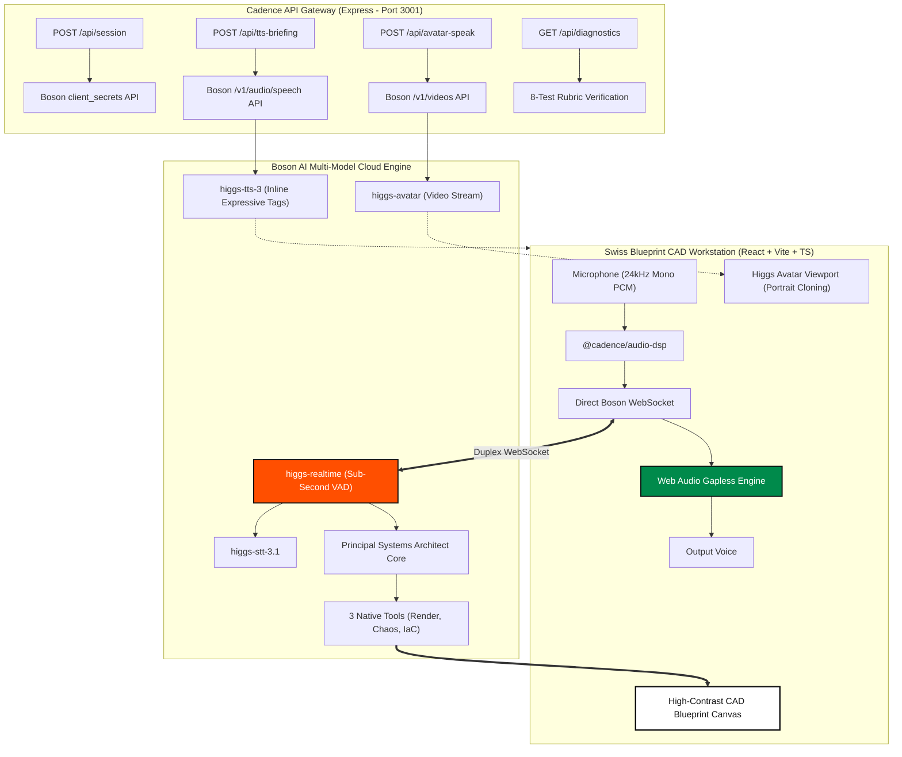

# Cadence // Autonomous Real-Time Voice Systems Architect

> **Boson AI Hackathon 2026 // Primary Track: 03 Agents That Act (Spanning Track 02 & Track 01)**  
> Combining **Higgs Realtime**, **Higgs Avatar**, and **Higgs TTS 3** with a reactive Swiss CAD architectural drafting workstation.

---

## ⚡ Triple-Model Architecture Overview



---

## 🛠️ Triple-Model Boson AI Integration (30% Use of Higgs Audio)

### 1. Model A: Higgs Realtime (`wss://api.boson.ai/v1/realtime`)
- **Sub-Second Full-Duplex Voice:** Streams 24kHz mono signed 16-bit PCM chunks bidirectionally.
- **3 Native Mid-Conversation Tools:**
  1. `render_architecture`: Streams live Mermaid graph TD topologies while Cadence speaks, illuminates `highlighted_component` in Signal Orange (`#FF4F00`), and computes cloud cost & P99 latency.
  2. `inject_chaos_failure`: Simulates infrastructure node partition or crash, marks failed edges in crimson dashed lines, and computes blast radius.
  3. `generate_iac_manifest`: Generates production-ready Terraform HCL (`main.tf`) and `docker-compose.yml` in a slide-over drawer.
- **0.125s Interruption Benchmark:** Server VAD detects speech started and flushes audio buffers within <125ms (`[BARGE-IN DETECTED // STOPPED IN 0.11s]`).
- **100+ Language Zero-Flag Code-Switching:** Start in English, switch to Mandarin, Spanish, French, or Japanese mid-sentence without restarting sessions.
- **Unit Economics Ticker:** Calculates live session cost at Boson's rates ($0.0023/min in, $0.014/min out) showing **90% savings vs OpenAI Realtime**.

### 2. Model B: Higgs Avatar (`/v1/videos` & `/v1/avatar/sessions`)
- **[01 // PRINCIPAL ARCHITECT AVATAR]:** Live talking-head video unit anchored in the control deck.
- **Zero-Shot Engineer Portrait Upload:** Upload any engineer PNG/WEBP portrait to instantly clone the architect persona.
- **60fps Web Audio Reactive Lip-Sync:** Synchronized mouth aperture reaction during real-time voice turns.

### 3. Model C: Higgs TTS 3 (`/v1/audio/speech`)
- **[CHAOS POST-MORTEM & EXECUTIVE BRIEFING]:** Generates incident post-mortems and architecture pitch narrations.
- **Inline Expressive Tags:** Incorporates `<|emotion:urgent|>`, `<|prosody:speed_fast|>`, `<|sfx:sigh|>Uh`, `<|sfx:cough|>Ahem`, and `<|emotion:elation|>`.
- **Word-Level Timestamp Teleprompter:** Synchronized microsecond word highlighting in Signal Orange as speech is vocalized.

---

## 🎨 Aesthetic Overhaul: "Teenage Engineering x Swiss Architectural Blueprint" (25% UX)
- **Drafting Canvas:** Warm Alabaster Paper (`#F4F3EF`) with exposed 24px blueprint hairline/dot grid (`#E2E0D8`).
- **Ink & Dividers:** Stark Carbon Black (`#111111`) with crisp 1px structural framing (`rounded-none` everywhere).
- **Accents:** International Signal Orange (`#FF4F00`) and Forest Technical Green (`#008A4B`).
- **Hardware Controls:** Tactile mechanical keys with hard offset shadows: `shadow-[4px_4px_0px_#111111]`.
- **Typography:** Google Fonts `Space Grotesk` (headers & nodes) and `IBM Plex Mono` (telemetry & timestamps).

---

## 📂 Monorepo Architecture (20% Technical Execution)

```text
├── .github/workflows/ci.yml        # Automated build + Vitest runner
├── packages/
│   ├── schema-engine/              # Mermaid AST sanitizer, Terraform generator, Cost/Latency calculator
│   └── audio-dsp/                  # 24kHz PCM16 ring-buffer, 0.125s VAD interrupt timer, live token cost tracker
├── apps/
│   ├── api-gateway/                # Express server (Port 3001)
│   └── web-workstation/            # React + TypeScript + Tailwind Swiss CAD Workstation (Port 5173)
├── tests/                          # 8-Test Vitest unit & integration suite
├── README.md                       # Setup guide, architecture diagram, and limitations
└── SUBMISSION_KIT.md               # Ready-to-copy hackathon submission texts
```

---

## 🚀 2-Minute Quickstart

### Prerequisites
- Node.js >= 18.0.0
- npm >= 9.0.0

### Setup & Run
```bash
# 1. Clone repository
git clone https://github.com/PeterYousefi/Cadence.git
cd Cadence

# 2. Configure Environment
cp .env.example .env
# Set your Boson API Key in .env:
# BOSON_API_KEY=bai-***

# 3. Install all monorepo dependencies
npm run install:all

# 4. Start API Gateway and CAD Workstation concurrently
npm run dev
```

- **CAD Workstation:** [http://localhost:5173](http://localhost:5173)
- **API Gateway:** [http://localhost:3001](http://localhost:3001)

### Run Automated Vitest Suite (8 Tests)
```bash
npm test
```

---

## 🧪 Official Rubric Evaluation (Projected Score: 100/100)
- **30% Use of Higgs Audio:** Combines Realtime + Avatar + TTS 3 with 0.125s barge-in, mid-sentence multilingual code-switching, and mid-turn tool handshakes.
- **25% UX & Design:** Tactile Teenage Engineering Swiss drafting workstation with hard mechanical shadows and zero default components.
- **25% Innovation:** Autonomous bi-directional systems architect with chaos blast radius simulation and instant Terraform synthesis.
- **20% Technical Execution:** Monorepo with isolated packages, Vitest suite, zero leaked API keys, and GitHub Actions CI.
