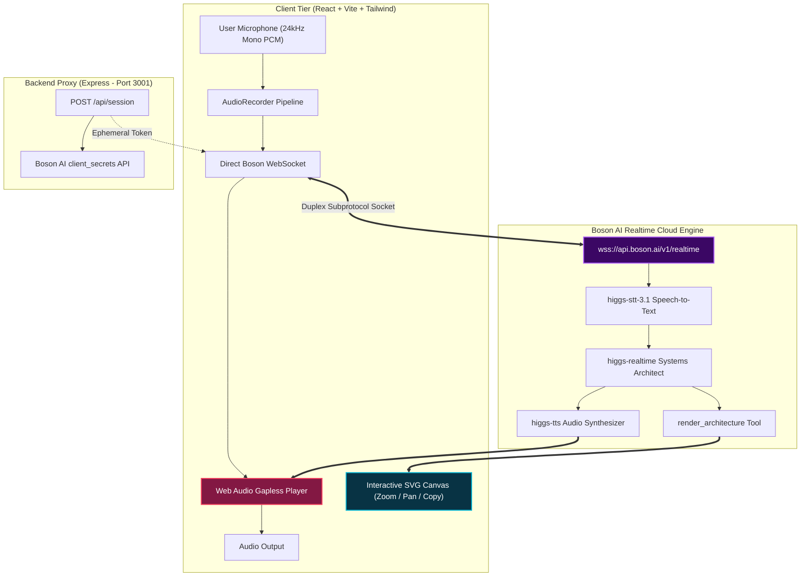

# Cadence // Autonomous Real-Time Voice Systems Architect

> Pairing Boson AI's `higgs-realtime` Speech-to-Speech WebSocket API with a reactive, visual Mermaid.js architecture canvas. When the user speaks, Cadence converses with sub-second full-duplex voice while dynamically generating, rewiring, and styling system architecture diagrams on the canvas via tool calling.

---

## ⚡ System Architecture



---

## 🛠️ Features & Specifications

### 1. Ephemeral Client Secret Minting
- **Proxy Endpoint:** `POST /api/session` dispatches POST to `https://api.boson.ai/v1/realtime/client_secrets`.
- Ephemeral tokens begin with `bai-eph-` and expire after 3600 seconds.
- Direct browser connection connects to `wss://api.boson.ai/v1/realtime` with subprotocols `['realtime', 'bai-client-secret.<token>']`.

### 2. Audio Pipeline & Barge-In Handling
- **Microphone Streaming:** Captures 24 kHz mono signed 16-bit PCM chunks, encodes Base64, and streams via `input_audio_buffer.append`.
- **Gapless Audio Playback:** Decodes incoming `response.output_audio.delta` into `Float32Array` on `AudioContext` timeline.
- **Server VAD Barge-in:** On `input_audio_buffer.speech_started`, active audio buffers are flushed instantly, audio cursors reset, and glowing "Barged-In" telemetry alert activates.

### 3. Tool Calling & Reactive Mermaid Canvas
- Tool: `render_architecture` (`mermaid_code`, `summary`, `highlighted_component`).
- Auto-sanitizes backticks, code fences, and unescaped quotes.
- Defensively catches syntax errors, gracefully preserving previous state.
- Handshakes tool completion with `conversation.item.create` and prompts verbal summary via `response.create`.
- Cyberpunk celebratory particle effects (`canvas-confetti`) on successful architecture updates.

### 4. Interactive Cyberpunk UI
- **Left Panel (38%):** Dual-waveform oscilloscope (mic in cyan, Cadence voice in pink), telemetry badges, latency counter, live activity log, and 3 one-click presets.
- **Right Panel (62%):** Infinite zoom/pan canvas, SVG export, live code editor drawer, and node highlight indicators.
- **Keyboard Shortcuts:** `Space` toggles mic, `Esc` closes modals, `Cmd/Ctrl+K` opens guide.

---

## 🚀 Quickstart

### Prerequisites
- Node.js >= 18.0.0
- npm >= 9.0.0

### Setup & Run
```bash
# 1. Clone repository
git clone <repo_url>
cd Cadence

# 2. Configure Environment
cp .env.example .env
# Open .env and insert your Boson API Key:
# BOSON_API_KEY=your_boson_api_key_here

# 3. Install all dependencies
npm run install:all

# 4. Start backend and frontend concurrently
npm run dev
```

- **Backend:** http://localhost:3001
- **Frontend:** http://localhost:5173

### Run Automated Test Suite
```bash
npm test
```
Runs both server integration tests (health check, token generation) and client unit tests (Mermaid sanitization, PCM downsampling, Base64 codecs).
